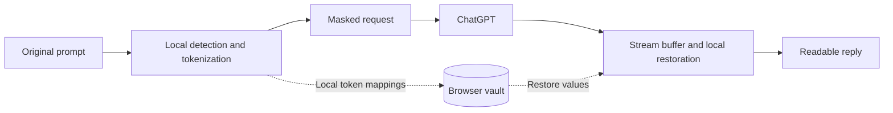

**A browser-native privacy layer for your AI conversations.**

Mask detected personal details before a ChatGPT request leaves your browser. Restore returned tokens locally, so the reply stays readable.

[](#quick-start) [](#the-cloak-experience) [](#see-it-in-chatgpt) [](#development)

**Chrome 111+** · **Manifest V3** · **ChatGPT** · **GPL-3.0**

---

## Privacy belongs in the workflow

Useful prompts often contain details that do not need to leave your device: a name, an email address, a phone number, a street address, or a private project name. Cloak replaces detected values with reversible tokens inside supported outgoing requests, then restores those tokens when they return in the response.

**No Cloak account. No Cloak server. No telemetry.** Detection and token mappings stay in your browser; ChatGPT receives the masked request.

## Quick start

**Requirements:** Google Chrome 111 or later and access to ChatGPT.

[](docs/downloads/cloak-extension.zip)

1. Download the extension ZIP above and extract it.
2. Open `chrome://extensions` and enable **Developer mode**.
3. Select **Load unpacked**, then choose the extracted `cloak` folder containing `manifest.json`.
4. Refresh ChatGPT. Open Cloak, confirm protection is on, and choose your coverage.

Start with fictional details in **Try** to inspect masking and restoration before using the extension in a conversation. The download includes the ready-to-load bundle and its source code; a build is not required for installation.

## The Cloak experience

| Control | What you can do |
| :--- | :--- |
| **Protection** | Check the current site’s support status and turn protection on or off. |
| **Try** | Preview how a prompt is masked and restored. |
| **Coverage** | Choose detection for names, email addresses, phone numbers, and street addresses. |
| **Custom terms** | Add exact terms such as private project names or internal references. |
| **Vault** | Search token mappings, reveal individual values, export entries, or clear them. |
| **Activity** | Review the extension’s local activity counters. |


Actual popup UI rendered with fictional activity and vault data. [Screenshot provenance](docs/assets/screenshots/provenance.json).

## See it in ChatGPT

A fictional patient-history prompt demonstrates the complete path: readable input, masked network payload, returned tokens, and a restored conversation. The captures below come from **one real Chrome session on October 25, 2026**.

[](docs/assets/medical-capture/02-payload.png)

| Stage | Inspect the capture |
| :--- | :--- |
| **01 · Before sending** | [The original prompt](docs/assets/medical-capture/01-original.png) contains a fictional name, email, phone, address, and medical history. |
| **02 · Outgoing request** | [DevTools payload](docs/assets/medical-capture/02-payload.png) shows PERSON, EMAIL, PHONE, and ADDRESS tokens. |
| **03 · Incoming response** | [Raw response](docs/assets/medical-capture/03-response.png) contains the name and email tokens. |
| **04 · Restored conversation** | The left pane of [the same response capture](docs/assets/medical-capture/03-response.png) displays the original name and email again. |

Three unaltered screenshots document four stages. [Capture provenance](docs/assets/medical-capture/provenance.json) records their hashes. Medical context remains in the outgoing request: this demonstrates identifier masking, not clinical guidance or HIPAA-compliant de-identification.

## Platform Compatibility & Current Status

**ChatGPT is the only supported platform in this release.**

| Platform | Status | Current implementation |
| :--- | :--- | :--- |
| **ChatGPT** | **Stable · supported** | Outgoing interception and incoming stream restoration, demonstrated in the live captures above. |
| **Google Gemini** | **Beta · experimental** | Outgoing protobuf interception is implemented. Incoming restoration has reported buffering pauses; a restoration patch is planned. |
| **Claude** | **Alpha · experimental** | Currently unsupported. WSS/WebSocket interception is planned for V2. |

Experimental integrations remain in the source and host permissions. Provider changes can affect compatibility; this table describes the current release scope.

## Architecture

Cloak operates between the page’s network requests and the AI provider. Its stream buffer retains incomplete token fragments so a token split across response chunks can be restored when complete.



| Layer | Implementation |
| :--- | :--- |
| **Request and response engine** | [`intercept.js`](intercept.js) wraps fetch and XMLHttpRequest for allowlisted chat requests; uses Compromise NLP, address parsing, regular expressions, and custom terms. |
| **Extension bridge** | [`content.js`](content.js) connects the page context to extension storage and provides composer indicators. |
| **Product interface** | [`popup.html`](popup.html), [`popup.js`](popup.js), and [`styles.css`](styles.css) implement the controls and vault. |
| **Interactive showcase** | [`docs/`](docs/README.md) contains the static website, real captures, and a separate preview build of the masking and streaming functions. |

## Verification

| Evidence | Recorded result | Scope |
| :--- | :--- | :--- |
| [Repository test suite](docs/assets/test-report.json) | **49 / 49 passed** · October 24, 2026 | Unit tests and simulated provider integrations. |
| [Synthetic masking exercise](docs/assets/synthetic-benchmark.json) | **1,024 exact round trips · 4,096 identifiers masked** | Generated prompts; restored text matched the original character for character. |
| [Live ChatGPT captures](docs/assets/medical-capture/) | **One conversation, four stages** | Direct observation of outgoing masking and incoming restoration. |
| [Website workbench](docs/index.html) | **Six executable checks + adjustable stream chunks** | Actual functions running locally in a separate preview build. |

The synthetic exercise varies email addresses, phone numbers, and street numbers across four task phrases with one fictional name. Its results are not a real-world detection-accuracy estimate, user count, or clinical validation.

## Privacy & data handling

| Area | Behavior |
| :--- | :--- |
| **Processing** | Detection and restoration run locally. Cloak has no backend or telemetry. |
| **Storage** | The vault uses `chrome.storage.local`. Values are concealed in the interface until revealed; storage is not encrypted by Cloak. |
| **External data** | The AI provider receives the masked request and applies its own data policies. Undetected details and context can remain. |
| **Coverage limits** | Pattern detection can miss details. Tokens are reversible placeholders, not encryption or certified de-identification. |
| **Media requests** | Detected image/video generation requests bypass masking and trigger a notice. |
| **Institutional use** | Organization policies, approvals, and legal obligations still apply. Cloak does not override AI restrictions or establish HIPAA compliance. |

Review sensitive prompts before sending. For healthcare workflows, consult your organization’s privacy and security process and [HHS de-identification guidance](https://www.hhs.gov/hipaa/for-professionals/special-topics/de-identification/index.html).

## Development

Install dependencies and build the browser bundle:

```sh
npm ci
npm run build:interceptor
```

Run the repository tests without rebuilding:

```sh
node --test tests/intercept.test.js tests/content.test.js
```

`npm test` also runs the interceptor build through its `pretest` script. Reload the unpacked extension and refresh ChatGPT after runtime changes.

Preview and verify the website:

```sh
node docs/serve.cjs
# Open http://127.0.0.1:4173
```

In another terminal:

```sh
node docs/verify.cjs
node docs/benchmark.cjs
```

The website uses plain HTML, CSS, and JavaScript. Its demos run without AI requests or access to the installed extension’s storage. See the [website guide](docs/README.md) for GitHub Pages deployment and download packaging, and the [test guide](tests/README.md) for test details.

## Built in North Carolina

Created by an eighth-grade student in **North Carolina’s 4th Congressional District** for the **2026 Congressional App Challenge**, represented by **Rep. Valerie Foushee**. Cloak explores a practical question for the Research Triangle: how can people use AI while keeping personal details under their control?

The project’s North Carolina research documents privacy-based AI restrictions and an illustrative adoption scenario. [Read the sources, population figures, and methodology](docs/impact-methodology.md).

## Roadmap

- **Broader evaluation:** expand detection testing beyond the current synthetic fixtures.
- **Provider compatibility:** improve Gemini restoration and investigate Claude transport support.
- **Permission-based sharing:** explore letting users approve a specific detail only when a task needs it.

These are planned directions. The compatibility matrix above defines what is supported today.

---

Licensed under [GPL-3.0](LICENSE). Built with [Compromise](https://github.com/spencermountain/compromise), [addressit](https://github.com/DamonOehlman/addressit), and [esbuild](https://github.com/evanw/esbuild).

Cloak is an independent student-built project. This repository is not an official congressional website.
