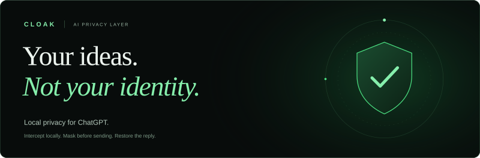
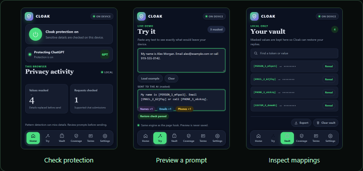

**Privacy at the network layer. Readability in the conversation.**

Cloak is a Chrome extension that masks detected personal details before a ChatGPT request leaves your browser, then restores returned tokens locally. Write naturally. Send placeholders. Read a familiar reply.

[](#quick-start) [](#see-it-in-chatgpt) [](#development)

**Chrome 111+** · **Manifest V3** · **ChatGPT** · **GPL-3.0**

## Why Cloak exists

The project starts with a question from North Carolina’s Research Triangle: **why should using AI mean handing over personal details?** Useful prompts can contain a name, an email, a phone number, an address, or a private project name. Cloak separates detected identifiers from the task and keeps their mappings in the browser.

**No Cloak account. No Cloak server. No telemetry.** The AI provider receives the masked request; Cloak restores recognized tokens as the response returns.

Built by an eighth-grade student in **North Carolina’s 4th Congressional District** for the **2026 Congressional App Challenge**, represented by **Rep. Valerie Foushee**.

## See how it works

See Cloak in a real ChatGPT conversation, review the test results, or try the interactive demos on the website.

| Test | Result | What was tested |
| :--- | :--- | :--- |
| Repository suite | **49 / 49 passed** | [October 24, 2026 report](docs/assets/test-report.json); unit tests and simulated provider integrations. |
| Synthetic exercise | **1,024 exact round trips · 4,096 identifiers masked** | [Saved results](docs/assets/synthetic-benchmark.json); generated prompts, not real-world accuracy. |
| Live ChatGPT session | **One conversation · four stages** | Original input, outgoing tokens, raw response, and restored UI below. |

On the website, edit a sample prompt to see which details Cloak masks and restores. You can also split a sample reply into chunks of 1 to 16 bytes to explore how streaming restoration works. Both demos use Cloak’s actual functions in a separate preview build.

## See it in ChatGPT

A fictional patient-history prompt makes the mechanism visible. These captures come from **one real Chrome session on October 25, 2026**.

[](docs/assets/medical-capture/02-payload.png)

| Stage | What to inspect |
| :--- | :--- |
| **01 · Before sending** | [Original prompt](docs/assets/medical-capture/01-original.png): fictional identifiers alongside the medical-history task. |
| **02 · Outgoing request** | [DevTools payload](docs/assets/medical-capture/02-payload.png): PERSON, EMAIL, PHONE, and ADDRESS tokens replace the detected values. |
| **03 · Incoming response** | [Raw response](docs/assets/medical-capture/03-response.png): the name and email return as tokens. |
| **04 · Restored conversation** | The left pane of [that same capture](docs/assets/medical-capture/03-response.png): the name and email are readable again. |

Three unaltered screenshots document four stages. [Capture details and file hashes](docs/assets/medical-capture/provenance.json). Medical context remains in the request; this is an identifier-masking demonstration, not clinical validation or HIPAA-compliant de-identification.

## Quick start

**Requires Google Chrome 111+ and access to ChatGPT.** No build is needed to install the packaged extension.

[](docs/downloads/cloak-extension.zip)

1. Download the ZIP and extract it.
2. Open `chrome://extensions` and enable **Developer mode**.
3. Select **Load unpacked** and choose the extracted `cloak` folder containing `manifest.json`.
4. Refresh ChatGPT. Open Cloak, confirm protection is on, and choose your coverage.

Use fictional details in **Try** to inspect masking and restoration first. The download includes the ready-to-load bundle, source, tests, and license.

## The Cloak experience



Actual popup interface with fictional activity and vault entries. [Screenshot details](docs/assets/screenshots/provenance.json).

| Control | Purpose |
| :--- | :--- |
| **Protection** | Check site support and switch protection on or off. |
| **Try** | Preview a prompt’s masked and restored text. |
| **Coverage** | Choose names, emails, phone numbers, and street addresses. |
| **Custom terms** | Add exact private terms, such as a project name. |
| **Vault** | Search mappings, reveal individual values, export entries, or clear them. |
| **Activity** | Review local activity counters. |

## The engineering

**Intercept → tokenize → restore.** The difficult part is preserving the conversation across both browser execution contexts and streaming response boundaries.

**Outgoing:** Your prompt → local detection → masked request → ChatGPT

**Incoming:** ChatGPT reply → stream buffer → restored text

The local vault stores token mappings so Cloak can restore the original values as the reply arrives.

| Challenge | Implementation |
| :--- | :--- |
| **Intercept page requests under Manifest V3** | [`intercept.js`](intercept.js) runs in the page’s main world and wraps fetch/XHR for allowlisted chat requests. [`content.js`](content.js) bridges that context to extension storage through postMessage. |
| **Mask text inside structured payloads** | The `rewriteBody` pipeline locates text, applies Compromise NLP, address parsing, regular expressions and custom terms, then rebuilds the request. |
| **Restore tokens split across chunks** | `restoreStream` buffers trailing token fragments until the token can be resolved and restored. Try this on the website by changing the size of incoming chunks. |
| **Make privacy controls usable** | [`popup.js`](popup.js), [`popup.html`](popup.html), and [`styles.css`](styles.css) provide coverage settings, a searchable vault, and local activity. |

## Platform Compatibility & Current Status

**ChatGPT is the only supported platform in this release.** The matrix below defines current support.

| Platform | Status | Current implementation |
| :--- | :--- | :--- |
| **ChatGPT** | **Stable · supported** | Outgoing interception and incoming stream restoration, demonstrated in the live captures. |
| **Google Gemini** | **Beta · experimental** | Outgoing protobuf interception is implemented. Incoming restoration has reported buffering pauses; a restoration patch is planned. |
| **Claude** | **Alpha · experimental** | Currently unsupported. WSS/WebSocket interception is planned for V2. |

Experimental integrations remain in the source and host permissions. Provider changes can affect compatibility.

## Privacy & data handling

- **Local processing:** detection, restoration and token mappings stay in the browser. Cloak has no backend or telemetry.
- **Local storage:** the vault uses `chrome.storage.local`. Values are concealed in the interface until revealed; Cloak does not encrypt that storage.
- **Defined coverage:** undetected details and context can remain in the request. Reversible tokens are placeholders, not encryption or certified de-identification.
- **Media behavior:** detected image/video generation requests bypass masking and trigger a notice.
- **Institutional use:** organization policies, approvals and legal obligations still apply. Cloak does not override AI restrictions or establish HIPAA compliance.

Review sensitive prompts before sending. The synthetic exercise varies emails, phones and street numbers across four task phrases with one fictional name; its results are not a clinical or real-world accuracy evaluation.

## Built in North Carolina

The saved source register documents **57 North Carolina organizations with published AI privacy limits and guidance** across education, government, business and healthcare. Its separate population subtotal covers **267,382 fall-2025 enrollments at 14 cited universities**.

If every student represented by that subtotal used ChatGPT with Cloak, the saved study assumptions model **97,274 sensitive messages per day—about 35.5 million per year**. This estimates potential exposure, not measured PII saved or actual adoption. [Inspect the sources, calculation and assumptions](docs/impact-methodology.md).

## Roadmap

- Expand detection evaluation beyond the current synthetic fixtures.
- Improve Gemini restoration and investigate Claude transport support.
- Explore user-approved sharing of a specific detail only when a task needs it.

## Development

```sh
npm ci
npm run build:interceptor
```

Run the existing tests without rebuilding:

```sh
node --test tests/intercept.test.js tests/content.test.js
```

`npm test` also rebuilds through `pretest`. Reload the unpacked extension and refresh ChatGPT after runtime changes.

The GitHub Pages site uses plain HTML, CSS and JavaScript. Its demos run without AI requests or access to the installed extension’s storage.

```sh
node docs/serve.cjs
# Open http://127.0.0.1:4173
```

In another terminal, run `node docs/verify.cjs`. Use `node docs/benchmark.cjs` to reproduce the synthetic exercise. See the [website guide](docs/README.md) for publishing and packaging, and the [test guide](tests/README.md) for test details.

---

Licensed under [GPL-3.0](LICENSE). Built with [Compromise](https://github.com/spencermountain/compromise), [addressit](https://github.com/DamonOehlman/addressit), and [esbuild](https://github.com/evanw/esbuild).

Independent student-built project. Not an official congressional website.
